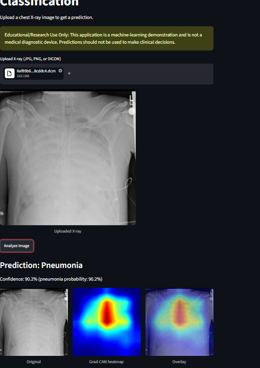
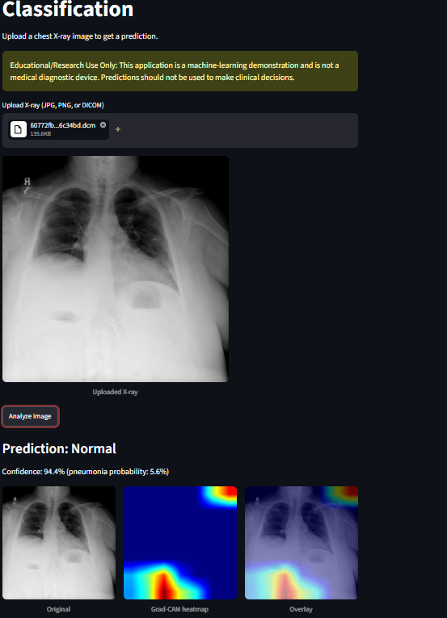

# Chest X-Ray Pneumonia Classification

Transfer-learning pipeline (DenseNet121) that classifies chest X-rays as pneumonia vs. not pneumonia, with Grad-CAM explanations and a Streamlit demo app.

> **Educational/Research Use Only.** This project is a machine-learning demonstration. It is not a medical diagnostic device, and its predictions must not be used for clinical decisions.

## Overview

End-to-end workflow: data analysis → leakage-safe split → baseline CNN → transfer learning (two architectures) → class-imbalance handling → evaluation beyond accuracy → error analysis → Grad-CAM → calibration → Streamlit app.




## Problem statement

Given a frontal chest X-ray, predict whether it shows pneumonia-related lung opacity. This is **image classification** (one label per image), not detection or segmentation, even though the source dataset also contains bounding boxes.

## Dataset

[RSNA Pneumonia Detection Challenge](https://www.kaggle.com/c/rsna-pneumonia-detection-challenge) (stage 2 training set, a subset of NIH ChestX-ray14 re-annotated by radiologists).

- 26,684 unique patients, one 1024×1024 grayscale DICOM each
- Binary target: `Target=1` (lung opacity / pneumonia) vs `Target=0` (everything else)
  - 6,012 positive / 20,672 negative (about 3.4:1)
  - The negative class mixes "Normal" (8,851) and "No Lung Opacity / Not Normal" (11,821), so the model separates pneumonia from *everything else*, not from healthy lungs only
- Split 70 / 15 / 15 (18,678 / 4,003 / 4,003), stratified by target. Each patient has one image, so image-level and patient-level splitting are equivalent here
- The data is not included in this repo. Download it from Kaggle (accept the competition rules first)

I chose this dataset over the commonly used Kermany pediatric dataset, which has documented train/test patient overlap, and over NIH ChestX-ray14, whose labels are mined from reports by NLP.

## Methodology

**Preprocessing:** DICOM → resize to 224×224 → replicate grayscale to 3 channels → ImageNet mean/std normalization.
**Augmentation (train only):** horizontal flip, rotation within ±8°, mild brightness/contrast jitter. No vertical flips or aggressive geometric transforms, since they can distort anatomy.

**Models compared**

| Model | Parameters | Training |
|---|---|---|
| Baseline CNN (4 conv blocks) | 389,633 | From scratch |
| DenseNet121 | 6,954,881 | ImageNet weights: frozen backbone → fine-tuned (lr 1e-5) |
| ResNet50 | 23,510,081 | Same two-stage recipe |

Common settings: batch size 32, Adam, BCE-with-logits loss, early stopping on validation loss, trained on a Colab T4 GPU.

**Class imbalance:** the final model was fine-tuned with `pos_weight` equal to the negative/positive ratio of the training split (about 3.4). Two checkpoints were kept (best validation loss, best validation F1).

## Results

All numbers below are on the **validation set** (4,003 images, 902 positives), threshold 0.5.

| Model | Accuracy | Precision | Recall | F1 | ROC-AUC | PR-AUC |
|---|---|---|---|---|---|---|
| Baseline CNN | 81.7% | 65.6% | 39.3% | 49.1% | 0.839 | 0.602 |
| ResNet50 (fine-tuned) | 83.7% | 69.7% | 48.9% | 57.5% | 0.864 | 0.663 |
| DenseNet121 (fine-tuned) | 83.9% | 67.6% | 55.2% | 60.8% | 0.867 | 0.669 |
| DenseNet121 + class weighting (best-loss ckpt) | 77.5% | 50.0% | 79.5% | 61.4% | 0.866 | 0.665 |
| **DenseNet121 + class weighting (best-F1 ckpt, deployed)** | 79.0% | 52.3% | 77.4% | 62.4% | 0.868 | 0.660 |

**Test-set results (final model, evaluated once):** _to be added_

**Why the weighted model is the one deployed:** class weighting roughly halved false negatives (404 → 204 missed pneumonia cases) at the cost of more false positives (239 → 638). For screening-style use, a missed case is generally costlier than a false alarm, so I favored recall, even though plain accuracy fell. ROC-AUC barely changed, which fits: weighting mainly moves the decision threshold rather than improving ranking.

**Calibration:** temperature scaling was fitted on the validation set (T = 1.0842 for the deployed model) and is applied to the confidence shown in the app. For the unweighted DenseNet121, expected calibration error was about 0.025 before and 0.023 after scaling.

## Error analysis and Grad-CAM

- **False positives** (confident, probability ≈ 0.96–0.97): the sampled cases contained visible lines, tubes or leads, and the Grad-CAM hotspots sat over the central chest. This pattern is consistent with the model mistaking dense equipment/overlying structures for consolidation. It is a hypothesis from a few examples, not a proven cause.
- **False negatives** (probability ≈ 0.01): Grad-CAM activation was weak or diffuse. These look like subtle or low-contrast opacities.
- **What Grad-CAM cannot show:** it highlights regions that influenced the score. It does not prove the region contains pneumonia, and it can highlight irrelevant features.

## Streamlit app

Upload a JPG, PNG or DICOM file, click **Analyze Image**, and the app shows the prediction, a calibrated confidence, and the original image, Grad-CAM heatmap and overlay. Predictions with probability between 35% and 65% are flagged as inconclusive.

**Live demo:** not deployed yet. Deployment is the next step of this project (planned: Hugging Face Spaces or Streamlit Community Cloud, both of which can host a Streamlit app from this repo).

## Installation

```bash
git clone https://github.com/YOUR-USERNAME/medical-image-classification.git
cd medical-image-classification
python -m venv venv
venv\Scripts\activate        # Windows (macOS/Linux: source venv/bin/activate)
pip install -r requirements.txt
```

On Windows, PyTorch needs the Microsoft Visual C++ Redistributable.

## Usage

```bash
streamlit run app/app.py
```

The app opens at `http://localhost:8501`. The trained weights are in `models/densenet121_weighted_bestf1.pt`.

## Project structure

```
app/app.py                          Streamlit application
src/data/dataset.py                 Dataset class used for training (preprocessing + augmentation)
models/                             Final trained weights
notebooks/                          Full experiment notebook (run in Google Colab)
results/figures/                    App screenshots
requirements.txt
```

## Challenges and lessons

- **Running out of Colab GPU quota.** I trained on the free Colab tier, and the daily GPU allowance ran out several times mid-training (for example during ResNet50 fine-tuning), which also reset the runtime and wiped everything in memory. I worked around it by keeping the dataset, splits and code on Google Drive, saving a checkpoint every time validation improved, and resuming from the last saved checkpoint instead of retraining. One consequence: a resumed run restarts the optimizer state, so it is not an exact continuation.
- **A training run that hung.** One weighted-loss epoch froze at 25% for about an hour. I interrupted it, resumed from the last checkpoint, and set `num_workers=0` in the data loaders. I suspect a data-loader worker problem when reading from Drive, but I did not confirm the cause.
- **Grad-CAM on DenseNet.** DenseNet's in-place ReLUs conflict with backward hooks. The fix was to read the gradient directly from the retained activation and to rebuild a fresh model copy for each Grad-CAM call so hooks do not pile up.
- **A wrong calibration metric.** My first expected-calibration-error implementation compared thresholded accuracy with confidence, which gave an impossible ECE above 1 after calibration. I caught it by checking against the metric's known bounds, rebuilt it around the positive rate per bin, and the corrected value was about 0.025.
- **Evaluation choices matter.** Selecting checkpoints by validation loss was not the best choice for this task, and plain accuracy hid the recall problem. That is why I report precision, recall, F1, ROC-AUC and PR-AUC.

## Limitations

- Validation-set numbers were used to choose the model and the checkpoint, so they are optimistic. The held-out test set gives the unbiased estimate.
- Recall is about 77% and precision about 52%. The deployed model still misses roughly one in four pneumonia cases and raises many false alarms.
- A single public dataset from one source. There was no external validation, so performance on other hospitals, scanners or processing pipelines is unknown. Scanner and hospital shift can degrade performance.
- The binary label lumps healthy lungs together with other abnormalities.
- Labels come from the dataset's annotation process and contain some noise.
- Calibration was measured on the unweighted model. The deployed model uses a re-fitted temperature, but its ECE was not re-measured.
- The error-analysis explanations are based on a small number of inspected images.
- Strong performance on a public dataset does not make a model clinically useful.

## Ethical considerations

This project is a learning and portfolio exercise. Real clinical use would require prospective validation, performance checks across patient demographics and sites, regulatory clearance, and human oversight of every prediction. Probabilities shown in the app are model estimates, not medical certainty.

## Future improvements

- Report test-set and subgroup results
- Evaluate on an external dataset to measure distribution shift
- Try EfficientNet and threshold tuning for a target sensitivity
- Re-measure calibration for the deployed model

## Acknowledgments

This project was built with significant help from Claude (Anthropic), which I used as a tutor and pair programmer for planning, explaining concepts, writing code and debugging. I ran the experiments myself, and the results reported here come from those runs.
